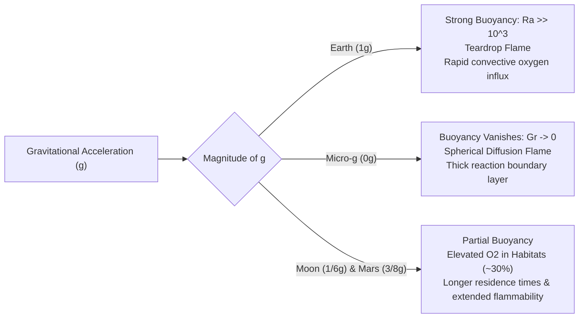
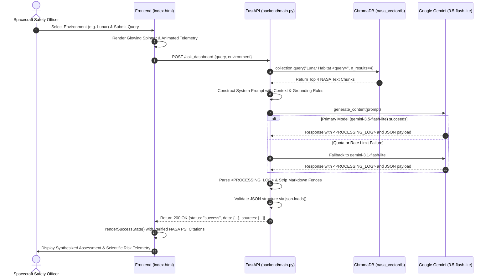

# 🔥 ZeroG Flames | Spaceflight Fire Safety AI Dashboard

> **An Autonomous Intelligence & Combustion Risk Assessment Engine for Microgravity, Lunar, and Martian Habitats**  
> *Powered by NASA Physical Sciences Informatics (PSI) Research, FastAPI, ChromaDB, Sentence-Transformers, and Google Gemini.*

---

## 📑 Table of Contents

1. [Executive Summary](#-executive-summary)
2. [Combustion Science Theory in Extraterrestrial Environments](#-combustion-science-theory-in-extraterrestrial-environments)
   - [Gravitational Buoyancy & The Grashof Paradox](#gravitational-buoyancy--the-grashof-paradox)
   - [Diffusion-Dominated Transport & Spherical Flames](#diffusion-dominated-transport--spherical-flames)
   - [Radiative Heat Loss, Soot Dynamics & Cool Flames](#radiative-heat-loss-soot-dynamics--cool-flames)
   - [Low-Speed Ventilation Flow & Flame Attachment](#low-speed-ventilation-flow--flame-attachment)
   - [Smoldering Combustion in Spaceflight](#smoldering-combustion-in-spaceflight)
3. [Mission Environments & Gravity Regimes](#-mission-environments--gravity-regimes)
   - [Space Station / Low Earth Orbit (Microgravity, 0g)](#1-space-station--low-earth-orbit-microgravity-0g)
   - [Lunar Habitat (Partial Gravity, 1/6g)](#2-lunar-habitat-partial-gravity-16g)
   - [Martian Base (Partial Gravity, 3/8g)](#3-martian-base-partial-gravity-38g)
4. [NASA Flight Investigations & Archival Context](#-nasa-flight-investigations--archival-context)
   - [ACME (Advanced Combustion via Microgravity Experiments)](#acme-advanced-combustion-via-microgravity-experiments)
   - [BASS & BASS-II (Burning and Suppression of Solids)](#bass--bass-ii-burning-and-suppression-of-solids)
   - [Saffire I – VI (Spacecraft Fire Safety Experiments)](#saffire-i--vi-spacecraft-fire-safety-experiments)
   - [FLEX & FLEX-2 (Flame Extinguishment Experiment)](#flex--flex-2-flame-extinguishment-experiment)
   - [DAFT (Dust and Aerosol Measurement Feasibility Test)](#daft-dust-and-aerosol-measurement-feasibility-test)
5. [System Architecture & RAG Pipeline](#-system-architecture--rag-pipeline)
6. [Exhaustive File-by-File Breakdown](#-exhaustive-file-by-file-breakdown)
   - [`backend/main.py`](#backendmainpy)
   - [`backend/ingest_pdf.py`](#backendingest_pdfpy)
   - [`backend/researchers_guide.pdf`](#backendresearchers_guidepdf)
   - [`frontend/index.html`](#frontendindexhtml)
   - [`extract_and_split.py`](#extract_and_splitpy)
   - [`nasa_vectordb/`](#nasa_vectordb)
   - [`requirements.txt`](#requirementstxt)
7. [Installation & Setup Guide](#-installation--setup-guide)
8. [API Reference & Schema Specification](#-api-reference--schema-specification)
9. [Terrestrial Applications & Earth Spinoffs](#-terrestrial-applications--earth-spinoffs)
10. [Troubleshooting & Developer Notes](#-troubleshooting--developer-notes)
11. [License & Acknowledgments](#-license--acknowledgments)

---

## 🚀 Executive Summary

**ZeroG Flames** is a mission-critical fire safety intelligence platform and decision-support system. It bridges decades of microgravity combustion physics research conducted aboard the International Space Station (ISS), space shuttles, drop towers, and sounding rockets with state-of-the-art **Retrieval-Augmented Generation (RAG)** and interactive telemetry visualization.

On Earth ($1g$), buoyancy drives hot combustion gases upward, pulling in ambient oxygen and creating the characteristic upward-pointing teardrop flame. In extraterrestrial environments—ranging from the near-weightlessness of the ISS to the partial gravity of the Moon ($1/6g$) and Mars ($3/8g$)—buoyancy is drastically reduced or eliminated. Consequently:
- Natural convection ceases to evacuate toxic combustion byproducts or replenish oxygen.
- Flame propagation transitions from convection-controlled to **diffusion-controlled** regimes.
- Low-speed forced ventilation (such as spacecraft air-conditioning) can sustain flames at lower oxygen concentrations and spread rates than predicted by terrestrial 1g testing (e.g., standard NASA-STD-6001 Test 1).

ZeroG Flames solves this operational challenge by ingesting NASA's scientific literature into a persistent vector database, querying the data via semantic embeddings, and utilizing Google Gemini models to synthesize actionable flammability assessments and telemetry data for space habitat safety.

---

## 🔬 Combustion Science Theory in Extraterrestrial Environments

To interpret the outputs of the ZeroG Flames dashboard, understanding the underlying thermal fluid dynamics and chemical kinetics of microgravity combustion is essential.



### Gravitational Buoyancy & The Grashof Paradox

In terrestrial combustion ($1g$), density gradients induced by thermal expansion generate a buoyant body force:

$$F_B = (\rho_\infty - \rho) g V$$

where $\rho_\infty$ is the ambient cold gas density, $\rho$ is the hot combustion zone density, $g$ is gravitational acceleration, and $V$ is the volume of the heated gas packet. 

The dominance of buoyancy is quantified by the **Grashof Number ($Gr$)** and **Rayleigh Number ($Ra$)**:

$$Gr = \frac{g \beta (T_f - T_\infty) L^3}{\nu^2}, \quad Ra = Gr \cdot Pr = \frac{g \beta (T_f - T_\infty) L^3}{\nu \alpha}$$

- $\beta$: Thermal expansion coefficient ($1/T_\infty$ for ideal gases)
- $T_f, T_\infty$: Flame temperature and ambient temperature
- $L$: Characteristic length scale
- $\nu$: Kinematic viscosity
- $\alpha$: Thermal diffusivity
- $Pr$: Prandtl number ($\nu / \alpha$)

On Earth, $Gr \gg 10^4$, causing rapid buoyant plume acceleration. In microgravity ($g \sim 10^{-6} g_0$), $Gr \to 0$ and $Ra \to 0$. Natural convection drops to zero, and the buoyant removal of combustion products collapses.

---

### Diffusion-Dominated Transport & Spherical Flames

When $Gr \approx 0$, momentum and mass transport are governed purely by **molecular diffusion** according to Fick's Second Law and Fourier's Conduction Law:

$$J_i = -D_i \nabla C_i, \quad q = -k \nabla T$$

1. **Geometry**: Without upward buoyant drag, fuel and oxidizer diffuse isotropically, transforming planar or conical flames into symmetrical **spherical flame envelopes**.
2. **Boundary Layer Thickness**: The reaction boundary layer thickens significantly compared to 1g. Reactants take longer to diffuse into the reaction zone, and heat conduction into unburned material spreads over a wider spatial envelope.
3. **Residence Time**: The residence time $\tau_{\text{res}} \sim L^2 / D$ of gas species inside the high-temperature zone increases by several orders of magnitude compared to convective buoyant residence times $\tau_{\text{conv}} \sim \sqrt{L / g}$.

---

### Radiative Heat Loss, Soot Dynamics & Cool Flames

The extended residence time and altered geometry in microgravity produce dramatic thermodynamic shifts:

1. **Elevated Radiative Loss Fraction ($X_{\text{rad}}$)**:  
   Because hot species ($\text{CO}_2$, $\text{H}_2\text{O}$) linger inside the reaction boundary rather than escaping rapidly, radiative heat loss can account for $30\%\text{--}60\%$ of total chemical heat release (compared to $<10\%$ in terrestrial flames).
2. **Lower Flame Temperature**:  
   Heightened radiative cooling drops the peak flame temperature from typical terrestrial values ($\sim 1800\text{--}2100\,\text{K}$) down to $\sim 1200\text{--}1500\,\text{K}$.
3. **Soot Agglomeration & Trapping**:  
   Soot particles nucleate and remain trapped between the spherical flame zone and the fuel surface. Instead of forming an upward smoking tail, soot builds up in a warm spherical shell, radiating intensely in the infrared.
4. **Low-Temperature "Cool Flames"**:  
   Discovered experimentally during the NASA **FLEX** investigation, liquid alkane droplets burning in microgravity can experience apparent flame extinction in the visible spectrum, yet continue burning invisibly via low-temperature chemical kinetics ($\sim 600\text{--}800\,\text{K}$) driven by alkylperoxy radical chemistry ($\text{R} + \text{O}_2 \leftrightarrow \text{RO}_2$).

---

### Low-Speed Ventilation Flow & Flame Attachment

In habitable spacecraft cabins, forced air circulation is mandatory ($u \approx 0.05\text{--}0.20\,\text{m/s}$) to prevent carbon dioxide buildup around sleeping crew members. 

Paradoxically, **low-speed forced airflow represents the most hazardous fire condition**:
- High-speed airflows ($u > 1\,\text{m/s}$) blow out microgravity flames by convective blow-off extinction.
- In zero airflow ($u = 0$), flames often self-extinguish due to buildup of their own inert combustion products ($\text{CO}_2, \text{H}_2\text{O}$) and oxygen starvation.
- **Critical Low Velocity ($0.01 < u < 0.1\,\text{m/s}$)**: The airflow continually supplies fresh oxygen to the flame without exerting sufficient convective cooling or aerodynamic strain to extinguish it. Solid materials (e.g., acrylics, wire insulation) burn **more vigorously and at lower oxygen limits** under this low-speed breeze than in normal 1g conditions.

---

### Smoldering Combustion in Spaceflight

Smoldering is a slow, low-temperature, flameless form of combustion sustained by the heat of direct heterogeneous oxygen attack on the surface of condensed-phase fuels (e.g., polyurethane foam, cotton fabric, electrical insulation):

$$\text{Fuel (solid)} + \text{O}_2 \longrightarrow \text{Char} + \text{Ash} + \text{CO} + \text{CO}_2 + \text{Heat}$$

In spaceflight:
- The absence of buoyancy allows the smolder zone to propagate silently inside thick insulation or electrical ducting without producing an obvious thermal plume.
- When cabin airflow shifts or an equipment bay hatch is opened, sudden oxygen ingress can cause the insidious smoldering zone to abruptly transition into violent, full-scale flaming.

---

## 🪐 Mission Environments & Gravity Regimes

ZeroG Flames categorizes its calculations and semantic retrieval filters across three operational environments:

| Mission Environment | Effective Gravity ($g$) | Atmospheric Composition | Typical Total Pressure | Primary Fire Hazards |
| :--- | :--- | :--- | :--- | :--- |
| **Space Station (ISS)** | Microgravity ($\sim 10^{-6}\,g$) | $21\%\,\text{O}_2$, $79\%\,\text{N}_2$ | $101.3\,\text{kPa}$ ($14.7\,\text{psia}$) | Diffusive spherical flames, smoke sensor misclassification, electrical rack smoldering. |
| **Lunar Habitat (Artemis)** | $1/6\,g$ ($1.62\,\text{m/s}^2$) | $\sim 30\%\text{--}34\%\,\text{O}_2$, bal. $\text{N}_2$ | $56\,\text{kPa}$ ($8.2\,\text{psia}$) | **Extreme flammability**: elevated oxygen concentration drops ignition energy and accelerates flame front spread over solid plastics (PMMA). |
| **Martian Base** | $3/8\,g$ ($3.71\,\text{m/s}^2$) | Variable $\text{O}_2$ ($\sim 25\text{--}30\%$) | $55\text{--}70\,\text{kPa}$ | Partial buoyancy creates weak upward plume; reduced radiative dissipation allows steady flame propagation. |

### 1. Space Station / Low Earth Orbit (Microgravity, 0g)
In the ISS habitable modules (Destiny, Columbus, Kibo, Node 2/3), fire detection relies on high-speed sampling particulate detectors. Because combustion creates large spherical soot agglomerates rather than fine 1g smoke plumes, detection algorithms must be specifically calibrated to avoid false alarms while catching early smoldering.

### 2. Lunar Habitat (Partial Gravity, 1/6g)
Planned exploration atmospheres for lunar surface habitats utilize reduced total pressure ($56.5\,\text{kPa}$ / $8.2\,\text{psi}$) and elevated oxygen fractions ($\sim 30\text{--}34\% \ \text{O}_2$) to permit rapid Extravehicular Activity (EVA) spacewalk transitions without requiring 4-hour pre-breathe decompression protocols. 
However, **materials that pass standard terrestrial 1g flammability testing at $21\%\,\text{O}_2$ burn vigorously in $34\%\,\text{O}_2$ at $1/6g$**. The lunar habitat is therefore designated in ZeroG Flames as the highest flame spread risk regime.

### 3. Martian Base (Partial Gravity, 3/8g)
At $0.38g$, gravity is high enough to induce buoyant flow, but too weak to generate the turbulent mixing that disperses flames on Earth. The result is a laminar, stable flame that is well-ventilated yet thermally insulated by slow-moving boundary layers.

---

## 🛰 NASA Flight Investigations & Archival Context

ZeroG Flames indexes empirical datasets and flight guides directly from NASA's Physical Sciences Informatics (PSI) repository:

```plaintext
                    NASA Physical Sciences Informatics (PSI)
                                       │
        ┌──────────────┬───────────────┴───────────────┬──────────────┐
        ▼              ▼                               ▼              ▼
     [ ACME ]       [ BASS ]                       [ Saffire ]     [ FLEX ]
  Gas Diffusion   Solid Fuel                     Large-Scale      Droplet &
  & Ion Flames    Flammability                    Spacecraft      Cool Flame
  (ISS CIR Rack)  (PMMA / Fabric)                 Cargo Fire      Combustion
```

### ACME (Advanced Combustion via Microgravity Experiments)
Carried out in the Combustion Integrated Rack (CIR) aboard the ISS, ACME encompassed six distinct microgravity flight investigations:
- **CFI (Coflow Flame Extinction)**: Defined the minimum oxygen limits required to sustain coflowing methane and propane flames.
- **E-FIELD Flames**: Investigated the effect of electric fields on ion transport in diffusion flames, demonstrating how ionic wind can simulate buoyancy forces without physical gravity.
- **Flame Design**: Analyzed soot production, radiation loss, and flame stability in oxygen-enriched and diluted atmospheres.

### BASS & BASS-II (Burning and Suppression of Solids)
Conducted in the Microgravity Science Glovebox (MSG) on the ISS:
- Evaluated the burning and extinction characteristics of solid materials including Polymethyl Methacrylate (PMMA) rods and slabs, cotton-fiberglass blends, and Nomex.
- Confirmed that materials burn at lower ambient air velocities in microgravity than in normal gravity, and proved that depressurization and nitrogen injection are effective suppression strategies.

### Saffire I – VI (Spacecraft Fire Safety Experiments)
Conducted by the NASA Glenn Research Center inside uncrewed Cygnus resupply vehicles after departing the ISS:
- Ignited large fabric/solid sheets ($0.4\,\text{m} \times 1.0\,\text{m}$) under realistic low-pressure, oxygen-rich exploration atmospheres.
- Proved that small-scale terrestrial flammability tests (NASA-STD-6001 Test 1) underpredict real flame propagation speeds by up to a factor of two in microgravity cabin conditions.

### FLEX & FLEX-2 (Flame Extinguishment Experiment)
- Examined isolated alkane and alcohol droplets suspended on ceramic fibers in the CIR.
- Discovered steady, quasi-steady, and cool flame combustion regimes where fuel continues to burn at low temperatures ($\sim 600\text{--}800\,\text{K}$) without generating chemiluminescence in the visible spectrum.

### DAFT (Dust and Aerosol Measurement Feasibility Test)
- Tested particle counter sensors on the ISS to distinguish between airborne planetary regolith (lunar/Martian dust) and combustion-generated soot particles.

---

## 🏛 System Architecture & RAG Pipeline



---

## 📁 Exhaustive File-by-File Breakdown

### `backend/main.py`
The central HTTP API and RAG orchestration server written in Python using FastAPI.

- **FastAPI Application Initialization**:  
  Instantiates the application as `app = FastAPI(title="ZeroG Flames Fire Safety API")`.
- **CORS Configuration**:  
  Configures `CORSMiddleware` with `allow_origins=["*"]`, `allow_credentials=False`, `allow_methods=["*"]`, and `allow_headers=["*"]`. This allows the static frontend (`frontend/index.html`) running on any port or local file path to communicate with the backend.
- **Vector Database Connection**:  
  Connects via `chromadb.PersistentClient(path=DB_PATH)` to the local vector directory (`nasa_vectordb`). Loads the `SentenceTransformerEmbeddingFunction` utilizing the `all-MiniLM-L6-v2` model and accesses the `combustion_experiments` collection.
- **Pydantic Request Schema**:  
  Defines `QueryRequest`:
  ```python
  class QueryRequest(BaseModel):
      query: str
      environment: str = "General"
  ```
- **System Prompt & Guardrails**:  
  Enforces domain boundaries:
  - Restricted strictly to habitable crew modules (spacecraft, Moon/Mars bases, rovers).
  - Explicitly commands the LLM to ignore rocket propellants and launch vehicle propulsion.
  - Mandates a Chain-of-Thought scratchpad enclosed in `<PROCESSING_LOG>...</PROCESSING_LOG>` tags.
  - Requires valid JSON output matching a defined schema with keys: `summary`, `key_variables`, `comparisons`, `terrestrial_applications`, and `confidence_warning`.
- **Dual-Model Failover Logic**:  
  Attempts inference first on `gemini-3.5-flash-lite`. If a quota exhaustion or API error occurs, it falls back to `gemini-3.1-flash-lite`.
- **Output Parsing & Sanitization**:  
  Splits out the console processing log, removes any markdown backtick fences (` ```json `), validates the JSON structure via `json.loads()`, and returns the structured payload alongside the raw NASA context sources.

---

### `backend/ingest_pdf.py`
The offline data ingestion and vector indexing script.

- **Function**: `process_pdf_to_vectordb(pdf_filepath)`
- **PDF Extraction**:  
  Uses `PyPDF2.PdfReader` to iterate through every page of the input PDF (e.g., `researchers_guide.pdf`), concatenating the full text with newline separators.
- **Text Chunking**:  
  Instantiates LangChain's `RecursiveCharacterTextSplitter`:
  ```python
  text_splitter = RecursiveCharacterTextSplitter(
      chunk_size=1000, 
      chunk_overlap=200,
      length_function=len
  )
  ```
  The 1,000-character chunk size preserves scientific paragraph integrity, while the 200-character overlap prevents sentences and equations from being truncated across boundaries.
- **Vector Embedding**:  
  Initializes `chromadb.utils.embedding_functions.SentenceTransformerEmbeddingFunction(model_name="all-MiniLM-L6-v2")`.
- **Persistent Storage**:  
  Creates or opens the ChromaDB collection `combustion_experiments` under `./nasa_vectordb` and adds the documents with unique identifier strings (`chunk_0`, `chunk_1`, ...).

---

### `backend/researchers_guide.pdf`
The primary source scientific document: **NASA's Physical Sciences Research Program Researcher's Guide to Combustion Science**.
- Details flight facilities (Combustion Integrated Rack, Microgravity Science Glovebox, drop towers).
- Contains quantitative flight data on flame spread, droplet extinction, fuel flammability boundaries, soot radiation, and spacecraft fire prevention standards.

---

### `frontend/index.html`
A single-file Mission Control web application engineered with modern glassmorphism and real-time telemetry.

- **Styling Architecture**:  
  Styled using Tailwind CSS (CDN) coupled with custom CSS:
  - Deep slate background palette (`#020617` with radial dark blue gradient).
  - Backdrop blur glass panels (`backdrop-filter: blur(16px)`).
  - Text gradient accents (`text-gradient-fire` and `text-gradient-cyan`).
  - Sleek custom scrollbars and animated pulse indicators.
- **Mission Environment Selector**:  
  Interactive radio group allowing one-click selection between:
  - *Lunar Habitat* ($1/6g$, $\sim 30\%\,\text{O}_2$)
  - *Martian Base* ($3/8g$, Variable $\text{O}_2$)
  - *Space Station* (Micro-$g$, $21\text{--}100\%\,\text{O}_2$)
- **Chart.js Risk Factor Telemetry**:  
  Renders a responsive bar chart comparing the flammability risk factor across three fuel types:
  1. *Solid Fuel (PMMA)*
  2. *Gaseous (Propane)*
  3. *Liquid Droplet*  
  Calling `updateDashboard()` recalculates the risk matrix based on the active gravity and oxygen profile (Lunar shows peak risk due to $30\%\,\text{O}_2$).
- **Earth Impact Telemetry Pane**:  
  Highlights terrestrial spinoffs (Firefighter Breathing Gear, DAFT Mine Smoke Detectors, ISS Fine-Water-Mist Suppression).
- **Asynchronous Execution & UI State Handling**:  
  The `simulateBackendCall()` function:
  1. Shows a glowing, animated circular spinner and telemetry status.
  2. Sends an asynchronous `POST` request to `http://127.0.0.1:8000/ask_dashboard`.
  3. Parses the response payload and invokes `renderSuccessState()`.
  4. In the event of a connection error, displays a diagnostic troubleshooting card detailing the exact network state and port.

---

### `extract_and_split.py`
A standalone diagnostic and extraction test harness.

- **Purpose**: Allows researchers and developers to test text extraction and chunk splitting parameters on arbitrary PDF files without touching the live vector database.
- **Dynamic Import Fallback**:  
  Supports both legacy LangChain (`langchain.text_splitter`) and modern split packages (`langchain_text_splitters`).
- **Inspection Utilities**:  
  Extracts text, computes character counts, executes `RecursiveCharacterTextSplitter`, and prints a preview of the first three chunks with character lengths.

---

### `nasa_vectordb/`
The persistent vector storage directory maintained by ChromaDB.

- **`chroma.sqlite3`**: SQLite metadata store managing collections, document mappings, IDs, and metadata tags.
- **UUID Directory (`f34d9b8c-...`)**: Contains the binary Hierarchical Navigable Small World (**HNSW**) graph index files:
  - `data_level0.bin`: High-dimensional vector points.
  - `header.bin`: Index configuration and dimensions ($384$ floats).
  - `length.bin`: Document length and quantization offsets.
  - `link_list.bin`: HNSW graph adjacency lists for $O(\log N)$ nearest-neighbor similarity search.

---

### `requirements.txt`
Specifies all Python dependencies required to run the ingestion pipeline and backend server:

```text
# Web API & Server
fastapi>=0.110.0
uvicorn[standard]>=0.28.0
pydantic>=2.6.0
python-multipart>=0.0.9

# Google Gemini Generative AI SDK
google-generativeai>=0.4.0

# Vector Database & Embeddings
chromadb>=0.4.24
sentence-transformers>=2.5.0
torch>=2.0.0
numpy>=1.24.0

# Document Ingestion, PDF Parsing & Chunking
PyPDF2>=3.0.0
pypdf>=4.0.0
langchain>=0.1.10
langchain-text-splitters>=0.0.1
langchain-community>=0.0.25

# Utilities
python-dotenv>=1.0.0
requests>=2.31.0
httpx>=0.27.0
```

---

## 🛠 Installation & Setup Guide

### 1. Prerequisites
- **Python 3.10 to 3.12** installed on your system.
- An active **Google Gemini API Key** from [Google AI Studio](https://aistudio.google.com/).

### 2. Clone the Repository
```bash
git clone https://github.com/drisyajnath-svg/ZeroG_Flames.git
cd ZeroG_Flames
```

### 3. Create & Activate a Virtual Environment
```bash
# Windows (PowerShell)
python -m venv venv
.\venv\Scripts\Activate.ps1

# Linux / macOS
python3 -m venv venv
source venv/bin/activate
```

### 4. Install Dependencies
```bash
pip install -r requirements.txt
```

### 5. Configure API Key
Open [backend/main.py](file:///c:/Users/Drisya%20J%20Nath/Desktop/NASA%20CHATBOT/ZeroG_Flames/backend/main.py) and ensure `GEMINI_API_KEY` is configured:
```python
GEMINI_API_KEY = "your-actual-api-key-here"
genai.configure(api_key=GEMINI_API_KEY)
```

### 6. Verify Database Path
In [backend/main.py](file:///c:/Users/Drisya%20J%20Nath/Desktop/NASA%20CHATBOT/ZeroG_Flames/backend/main.py#L29), verify `DB_PATH`. For cross-platform compatibility, you can use:
```python
import os
BASE_DIR = os.path.dirname(os.path.dirname(os.path.abspath(__file__)))
DB_PATH = os.path.join(BASE_DIR, "nasa_vectordb")
```

### 7. Run Ingestion (Optional if `nasa_vectordb` already exists)
```bash
python backend/ingest_pdf.py
```

### 8. Start the FastAPI Server
```bash
cd backend
uvicorn main:app --reload --host 127.0.0.1 --port 8000
```
Confirm the backend is live by opening [http://127.0.0.1:8000/docs](http://127.0.0.1:8000/docs) in your browser.

### 9. Open the Frontend
Launch [frontend/index.html](file:///c:/Users/Drisya%20J%20Nath/Desktop/NASA%20CHATBOT/ZeroG_Flames/frontend/index.html) directly in any modern browser, or serve it via:
```bash
cd frontend
python -m http.server 3000
```
Navigate to [http://localhost:3000](http://localhost:3000).

---

## 📡 API Reference & Schema Specification

### Endpoint: `POST /ask_dashboard`

Executes semantic context retrieval over the NASA combustion database and streams the query to Gemini with prompt constraints.

#### Request Headers
`Content-Type: application/json`

#### Request Payload
```json
{
  "query": "Analyze flammability limits of PMMA solid fuels in 30% oxygen.",
  "environment": "Lunar Habitat"
}
```

#### Response Payload (`200 OK`)
```json
{
  "status": "success",
  "data": {
    "summary": "In elevated oxygen environments (~30% O2) representative of Lunar habitats, solid PMMA fuel experiences a significant reduction in ignition delay time and an accelerated flame spread rate. Due to 1/6g partial gravity, buoyant heat removal is weak, sustaining a thick thermal boundary layer that facilitates continuous pyrolysis and flame spread even under low convective airflow.",
    "key_variables": {
      "fuel_type": "Polymethyl Methacrylate (PMMA)",
      "oxygen_concentration": "30%",
      "gravity_level": "1/6 g (Lunar)"
    },
    "comparisons": "Compared to terrestrial 1g combustion where buoyant convection dissipates heat rapidly, 1/6g partial gravity extends the flammability limit, meaning PMMA burns at lower velocities and higher temperatures.",
    "terrestrial_applications": "Informs the design of fire-retardant polymers and high-oxygen medical hyperbaric chamber safety protocols.",
    "confidence_warning": null
  },
  "sources": [
    "NASA Physical Sciences Informatics excerpt chunk 1...",
    "NASA Physical Sciences Informatics excerpt chunk 2...",
    "NASA Physical Sciences Informatics excerpt chunk 3...",
    "NASA Physical Sciences Informatics excerpt chunk 4..."
  ]
}
```

---

## 🌍 Terrestrial Applications & Earth Spinoffs

Spaceflight combustion research does not stay in space. Eliminating buoyancy on the ISS exposes fundamental combustion and suppression physics that are masked by gravity on Earth:

```plaintext
┌──────────────────────────────────────────────────────────────────────────┐
│              NASA MICROGRAVITY RESEARCH -> EARTH SPINOFFS               │
├──────────────────────────┬───────────────────────────────────────────────┤
│ Space Experiment         │ Terrestrial Earth Technology                  │
├──────────────────────────┼───────────────────────────────────────────────┤
│ DAFT Aerosol Test        │ Dual-wavelength industrial mine smoke sensors │
│ FLEX Droplet Experiments │ Clean-burning, ultra-efficient diesel fuel    │
│ ISS Water Mist System    │ Non-toxic server room fire extinguishing tech │
│ Spacesuit Thermal Layers │ Lightweight, heat-resistant firefighter gear  │
│ ACME Soot & Clean Flames │ Reduced soot emissions in gas power turbines  │
└──────────────────────────┴───────────────────────────────────────────────┘
```

1. **Industrial Mine Smoke Detectors (DAFT Spinoff)**:  
   Standard optical smoke detectors frequently trigger false alarms in mining and heavy industrial sites due to airborne dust. NASA's DAFT investigation pioneered multi-wavelength optical sensors that distinguish between jagged mineral dust particles and spherical carbon soot particles.
2. **Fine-Water-Mist Fire Extinguishers**:  
   Traditional chemical extinguishing agents (e.g., Halon) produce toxic breakdown products hazardous in sealed spacecraft life-support loops. NASA engineered high-pressure micro-nozzles delivering droplets under $50\,\mu\text{m}$. Today, these systems protect terrestrial server farms, archives, and naval ships without causing water damage.
3. **Advanced Firefighter Turnout Gear**:  
   Polybenzimidazole (PBI) fibers and aluminized thermal barriers developed for Apollo and Space Shuttle suits form the gold standard in modern municipal firefighting gear, protecting against radiant heat up to $1000^\circ\text{C}$.

---

## 🛠 Troubleshooting & Developer Notes

| Symptom | Probable Cause | Resolution |
| :--- | :--- | :--- |
| `Connection Error: Failed to fetch` | FastAPI backend is not running or running on an unexpected port. | Start the backend via `uvicorn main:app --reload --port 8000` and confirm [http://127.0.0.1:8000/docs](http://127.0.0.1:8000/docs) loads. |
| `ChromaDB database path error` | `DB_PATH` is hardcoded to a directory path that does not match your machine. | Update `DB_PATH` in `backend/main.py` to use a dynamic relative path: `os.path.join(os.path.dirname(__file__), "..", "nasa_vectordb")`. |
| `ResourceExhausted: 429 Quota Exceeded` | Gemini free tier API request rate limit reached. | The backend automatically attempts failover to `gemini-3.1-flash-lite`. You can also provide a key from a paid Google Cloud project. |
| `CORS Error in Browser Console` | Frontend is blocked from accessing the API. | Verify `app.add_middleware(CORSMiddleware, allow_origins=["*"])` is present in `backend/main.py`. |

---

## 📜 License & Acknowledgments

- **Lead Developer**: Drisya J Nath
- **Scientific Data Credits**: NASA Physical Sciences Informatics (PSI) system, NASA Glenn Research Center, and NASA Johnson Space Center.
- **License**: Released under the [MIT License](LICENSE) for research, academic, and exploration safety development.
