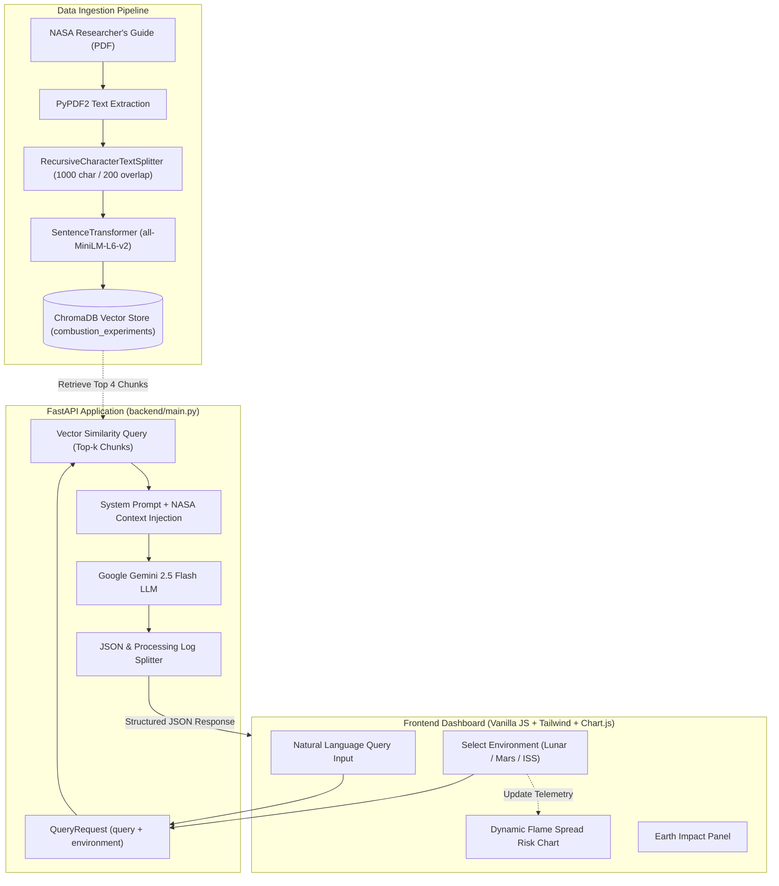

# 🔥 ZeroG Flames | Spaceflight Fire Safety AI Dashboard

> **Advanced Combustion Intelligence & Risk Assessment Engine for Microgravity and Extraterrestrial Habitats**  
> *Powered by NASA Physical Sciences Informatics (PSI) Research, FastAPI, ChromaDB, and Google Gemini 2.5 Flash.*

---

## 📌 Table of Contents

- [Overview](#-overview)
- [Mission & Scientific Background](#-mission--scientific-background)
- [Key Features](#-key-features)
- [System Architecture](#-system-architecture)
- [Tech Stack](#-tech-stack)
- [Project Directory Structure](#-project-directory-structure)
- [Getting Started](#-getting-started)
  - [Prerequisites](#prerequisites)
  - [1. Clone the Repository](#1-clone-the-repository)
  - [2. Create a Virtual Environment & Install Dependencies](#2-create-a-virtual-environment--install-dependencies)
  - [3. Configure Environment Variables](#3-configure-environment-variables)
  - [4. Ingest NASA Combustion Research into ChromaDB](#4-ingest-nasa-combustion-research-into-chromadb)
  - [5. Launch the FastAPI Backend](#5-launch-the-fastapi-backend)
  - [6. Open the Frontend Dashboard](#6-open-the-frontend-dashboard)
- [API Reference](#-api-reference)
- [Scientific Context & NASA Investigations](#-scientific-context--nasa-investigations)
- [Terrestrial Earth Applications (Spinoffs)](#-terrestrial-earth-applications-spinoffs)
- [Troubleshooting & Tips](#-troubleshooting--tips)
- [License & Acknowledgments](#-license--acknowledgments)

---

## 🌌 Overview

**ZeroG Flames** is an interactive spaceflight fire safety intelligence dashboard and retrieval-augmented generation (RAG) assistant designed for mission planners, spacecraft engineers, and payload safety officers.

In spaceflight, fire behaves contrary to human intuition on Earth. Without gravity-driven natural convection:
- Buoyant forces vanish, turning typical teardrop-shaped flames into **spherical, low-radiance diffusion flames**.
- Flammability limits and extinction criteria widen significantly.
- Atmospheric variations (e.g., higher oxygen concentrations in lunar surface modules) escalate fire hazards.

ZeroG Flames indexes NASA's microgravity combustion datasets (including research guides, ACME, and BASS flight experiments), allowing users to run semantic safety queries, examine flammability thresholds across distinct gravitational environments, and visualize multi-fuel risk factors in real time.

---

## 🔬 Mission & Scientific Background

ZeroG Flames specifically categorizes crewed spaceflight fire hazards across three operational gravitational regimes:

| Regime | Gravity Level ($g$) | Habitat Atmosphere | Combustion Dynamics |
| :--- | :--- | :--- | :--- |
| **Space Station (ISS)** | Microgravity ($\approx 0\,g$) | $21\% - 100\%\,\text{O}_2$, $1\,\text{atm}$ | Zero buoyancy; spherical flames; transport dominated purely by diffusion and forced ventilation airflow. |
| **Lunar Habitat** | $1/6\,g$ ($\approx 0.166\,g$) | $\sim 30\%\,\text{O}_2$, reduced pressure | Sub-buoyant flow; elevated $\text{O}_2$ dramatically enhances flame spread velocity across solid polymers (e.g., PMMA). |
| **Martian Base** | $3/8\,g$ ($\approx 0.375\,g$) | Variable $\text{O}_2$, low-pressure mix | Partial buoyancy intermediate between lunar and terrestrial conditions; bounded by 0g and 1g combustion data. |

> **Note:** ZeroG Flames strictly evaluates fire safety for **habitable crew environments** (spacecraft cabins, lunar/Martian bases, pressurized rovers) and isolates these from rocket propellant combustion.

---

## ✨ Key Features

- **Semantic Vector Search (ChromaDB)**: Chunks and embeds NASA Physical Sciences Informatics (PSI) literature using the `all-MiniLM-L6-v2` SentenceTransformer model for sub-second similarity retrieval.
- **Context-Bound LLM Reasoning (Google Gemini 2.5 Flash)**: Generates verified fire safety evaluations with a structured `<PROCESSING_LOG>` breakdown and strict JSON response formatting.
- **Glassmorphic Mission Control UI**: High-contrast, dark-theme interface built with Tailwind CSS, custom radial lighting, and Lucide icons.
- **Interactive Risk Telemetry (Chart.js)**: Real-time risk factor assessment visualizing flammability across:
  - Solid fuels (e.g., Polymethyl Methacrylate / PMMA)
  - Gaseous fuels (e.g., Propane)
  - Liquid fuel droplets
- **Earth Impact Showcase**: Dedicated telemetry pane highlighting terrestrial spinoffs born from microgravity combustion experiments (mine smoke detectors, fine-water-mist fire extinguishers, firefighter protective apparel).
- **Built-in Fallback Simulation**: Robust UI simulation pipeline ensuring presentation readiness even when running offline or decoupled from the API server.

---

## 🏗 System Architecture



---

## 🛠 Tech Stack

### Backend & AI
- **Language**: Python 3.10+
- **API Framework**: [FastAPI](https://fastapi.tiangolo.com/) with [Uvicorn](https://www.uvicorn.org/)
- **LLM / Generative AI**: [Google Generative AI](https://ai.google.dev/) (`gemini-2.5-flash`)
- **Vector Database**: [ChromaDB](https://www.trychroma.com/) (`chromadb.PersistentClient`)
- **Embeddings**: [Hugging Face Sentence-Transformers](https://sbert.net/) (`all-MiniLM-L6-v2`)
- **Document Processing**: [LangChain](https://www.langchain.com/) (`RecursiveCharacterTextSplitter`), [PyPDF2](https://pypdf2.readthedocs.io/)

### Frontend
- **Markup & Scripting**: HTML5, Vanilla JavaScript (ES6+)
- **Styling**: [Tailwind CSS](https://tailwindcss.com/) (CDN) with custom glassmorphism & gradients
- **Data Visualization**: [Chart.js](https://www.chartjs.org/)
- **Icons**: [Lucide Icons](https://lucide.dev/)

---

## 📂 Project Directory Structure

```plaintext
ZeroG_Flames/
├── backend/
│   ├── ingest_pdf.py             # Script to extract, chunk, and embed NASA research into ChromaDB
│   ├── main.py                   # FastAPI application with Gemini RAG pipeline & endpoints
│   └── researchers_guide.pdf     # Primary NASA Physical Sciences Informatics combustion guide
├── frontend/
│   └── index.html                # Single-page Mission Control fire safety dashboard
├── nasa_vectordb/                # Persistent ChromaDB vector storage (generated by ingest_pdf.py)
│   ├── chroma.sqlite3
│   └── [UUID]/                   # HNSW index files and embeddings
├── extract_and_split.py          # Standalone test utility for text extraction & chunk testing
└── README.md                     # Project documentation
```

---

## 🚀 Getting Started

### Prerequisites

Ensure you have the following installed on your system:
- **Python 3.10 or higher**
- **pip** (Python package manager)
- A **Google Gemini API Key** ([Get one here from Google AI Studio](https://aistudio.google.com/))
- Modern web browser (Chrome, Edge, Firefox, or Safari)

---

### 1. Clone the Repository

```bash
git clone https://github.com/drisyajnath-svg/ZeroG_Flames.git
cd ZeroG_Flames
```

---

### 2. Create a Virtual Environment & Install Dependencies

Create and activate a clean Python virtual environment:

**On Windows (PowerShell):**
```powershell
python -m venv venv
.\venv\Scripts\Activate.ps1
```

**On Linux / macOS:**
```bash
python3 -m venv venv
source venv/bin/activate
```

Install required packages:
```bash
pip install fastapi uvicorn pydantic chromadb sentence-transformers google-generativeai pypdf2 langchain langchain-text-splitters
```

---

### 3. Configure Environment Variables

The backend requires your Gemini API key to interact with Google's models.

In `backend/main.py`, you can set the key directly or export it as an environment variable:

```bash
# On Windows PowerShell
$env:GEMINI_API_KEY="your-gemini-api-key-here"

# On Linux / macOS
export GEMINI_API_KEY="your-gemini-api-key-here"
```

> ⚠️ **Security Warning:** Avoid committing raw API keys into public repositories. Use an `.env` file or environment variables in production.

---

### 4. Ingest NASA Combustion Research into ChromaDB

Before running queries, populate the vector database with chunks from the NASA research guide:

```bash
python backend/ingest_pdf.py
```

This will:
1. Extract text page-by-page from `backend/researchers_guide.pdf`.
2. Chunk the content using a 1,000-character window with a 200-character overlap.
3. Compute vector representations via `all-MiniLM-L6-v2`.
4. Store persistent vectors in `./nasa_vectordb`.

---

### 5. Launch the FastAPI Backend

Run the server using Uvicorn:

```bash
cd backend
uvicorn main:app --reload --host 0.0.0.0 --port 8000
```

The API will be available at:
- **Interactive Swagger Docs**: [http://localhost:8000/docs](http://localhost:8000/docs)
- **ReDoc Documentation**: [http://localhost:8000/redoc](http://localhost:8000/redoc)

---

### 6. Open the Frontend Dashboard

Simply open `frontend/index.html` in your web browser:
- Double-click `frontend/index.html`, or
- Serve it via a local lightweight server:

```bash
# Using Python's built-in HTTP server
cd frontend
python -m http.server 3000
```

Then visit [http://localhost:3000](http://localhost:3000).

---

## 📡 API Reference

### `POST /ask_dashboard`

Executes a semantic similarity query against NASA combustion research data and generates an evaluation through Gemini 2.5 Flash.

#### Request Body (`application/json`)

```json
{
  "query": "What are the flammability limits of PMMA solid fuel under elevated oxygen?",
  "environment": "Lunar Habitat"
}
```

| Field | Type | Required | Description |
| :--- | :--- | :--- | :--- |
| `query` | `string` | **Yes** | Natural language safety query or material analysis question. |
| `environment` | `string` | No | Operational regime (e.g., `"Lunar Habitat"`, `"Martian Base"`, `"Space Station"`). Default: `"General"`. |

#### Response (`application/json`)

```json
{
  "status": "success",
  "data": {
    "summary": "In elevated oxygen environments (~30% O2) typical of proposed Lunar habitats, solid PMMA fuels exhibit significantly reduced ignition delay and higher flame spread rates. The lower gravitational acceleration (1/6g) reduces buoyant clearing, extending extinction limits and increasing smolder-to-flame risk.",
    "key_variables": {
      "fuel_type": "Polymethyl Methacrylate (PMMA)",
      "oxygen_concentration": "30%",
      "gravity_level": "1/6 g (Lunar)"
    },
    "comparisons": "Compared to 1g terrestrial conditions, the buoyant flow is weak, yielding thicker flame boundaries and longer residence times.",
    "terrestrial_applications": "Informs flammability testing standards and fire protection design in oxygen-enriched industrial enclosures.",
    "confidence_warning": null
  },
  "sources": [
    "... [Raw NASA PSI context excerpt 1] ...",
    "... [Raw NASA PSI context excerpt 2] ..."
  ]
}
```

---

## 🧪 Scientific Context & NASA Investigations

ZeroG Flames incorporates scientific data derived from landmark NASA spaceflight combustion investigations:

- **ACME (Advanced Combustion via Microgravity Experiments)**:  
  Conducted in the Combustion Integrated Rack (CIR) on the ISS to investigate soot production, flame structure, and gaseous flame extinction limits.
- **BASS & BASS-II (Burning and Suppression of Solids)**:  
  Studied the burning behavior of solid fuels (PMMA, plastic sheets, fabric) in microgravity to develop more accurate spacecraft material screening tests.
- **Saffire (Spacecraft Fire Safety Experiments)**:  
  Large-scale flame spread tests conducted aboard uncrewed Cygnus cargo resupply vehicles to observe real-scale spacecraft fire propagation.
- **FLEX (Flame Extinguishment Experiment)**:  
  Detailed droplet combustion tests evaluating the effectiveness of gaseous suppressants in microgravity.

---

## 🌍 Terrestrial Earth Applications (Spinoffs)

Research conducted in microgravity frequently transitions into transformative safety technologies on Earth:

1. **Advanced Mine & Industrial Smoke Detectors**:  
   Instruments designed to monitor particulate size in zero-gravity (such as the **DAFT** experiment) led to dual-wavelength smoke detectors capable of differentiating dangerous combustion smoke from harmless industrial dust.
2. **Fine-Water-Mist Fire Suppression**:  
   Because chemical suppressants can be toxic in closed-loop life support systems, NASA developed high-efficiency ultra-fine water mist systems that extinguish fires without flooding sensitive electronics.
3. **Firefighter Thermal Protection & Respiratory Systems**:  
   Materials engineered for astronaut space suits and spacecraft insulation now form the core of ultra-heat-resistant fabrics and lightweight breathing apparatuses utilized by municipal fire departments worldwide.

---

## 💡 Troubleshooting & Tips

- **ChromaDB Path in `backend/main.py`**:  
  If the API throws a database error, verify that `DB_PATH` in `backend/main.py` points to your active `./nasa_vectordb` folder or set it relative to the file location:
  ```python
  import os
  BASE_DIR = os.path.dirname(os.path.dirname(os.path.abspath(__file__)))
  DB_PATH = os.path.join(BASE_DIR, "nasa_vectordb")
  ```
- **Port Conflict (Port 8000)**:  
  If port `8000` is already in use, run Uvicorn on another port (e.g., `--port 8080`) and update the fetch endpoint in `frontend/index.html`.
- **CORS Setup**:  
  `main.py` includes `CORSMiddleware` configured with `allow_origins=["*"]` to ensure the local frontend can query the API without cross-origin blocks.

---

## 📄 License & Acknowledgments

- **Data Sources**: NASA Physical Sciences Informatics (PSI) system and the NASA Glenn Research Center Combustion Science branch.
- **Developer**: Drisya J Nath
- **License**: Released under the [MIT License](LICENSE) for educational, research, and non-commercial development.
